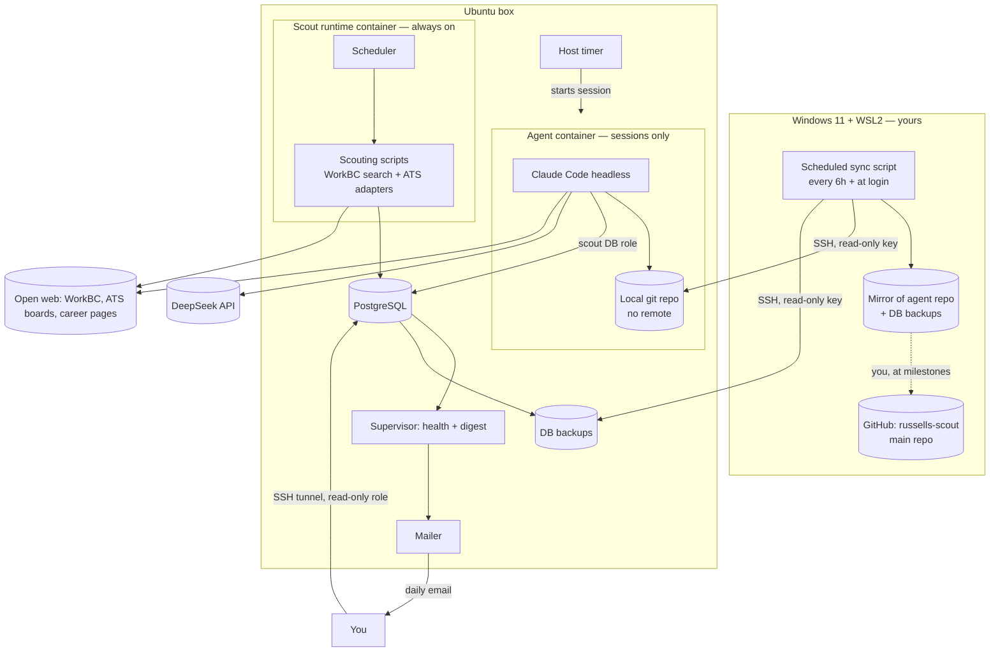

# Project Scout: Autonomous Job-Scouting System
## Architecture and Implementation Plan — v3.2

**Status:** Revised design (v3.2, 2026-10-30: WorkBC-first scouting; v3.1, 2026-10-28: fresh box deployment), supersedes v3.0 and v2.2
**Repository:** `russells-scout` (public main repo on GitHub; the box clones and pulls it read-only, holds no GitHub credentials and never pushes)
**Host:** Dedicated headless Ubuntu 26.04 machine (2012 Mac mini), amd64, 10 GB RAM, Docker installed; administered over SSH from WSL2 as `shaw2012`. Everything Scout uses lives under `/srv/scout` (code in `/srv/scout/code`)
**Language:** Python (scouting code); Node (Claude Code runtime)
**Database:** PostgreSQL (same host). The database is the system's output.
**Agent:** Claude Code, running headless in a hardened container, using the DeepSeek API (`deepseek-flash`) through DeepSeek's Anthropic-compatible endpoint. No Claude account.
**Budget:** $10 per month, prepaid on DeepSeek, auto top-up off. When it runs out, the agent waits for next month.
**Core principle:** The agent builds and maintains the scouting; it does not scout by hand. Scouting scripts run on timers and use zero LLM tokens.

### What changed from v2.2

| Area | v2.2 | v3.0 |
|---|---|---|
| Agent | OpenHands SDK with custom tools | Claude Code (headless) on DeepSeek; a ready-made agent with a real shell inside its container |
| Agent role | Narrow orchestrator acting only through `scoutctl` | Capable operator: works out the scouting itself, writes and fixes the scripts; human only checks results |
| Budget | Gateway with daily dollar slices and a usage ledger | $10/month prepaid balance is the only limit; no spend tracking; token-sensitive design plus per-session turn limit and timeout |
| LLM gateway | Local gateway holding keys and budgets | Removed. Claude Code calls DeepSeek directly |
| Groq fallback | Optional fallback via gateway | Dropped for now (open item) |
| Web access | Domain allowlists per source | Open web access with a small blast radius, plus site-safety rules and per-listing trust scoring |
| Code flow | Autonomous gated deploys from a repo clone | Box installs and updates from a read-only `git clone` of the public main repo (v3.1; v3.0 used a zip); agent commits to a local git repo with no remote; WSL2 pulls automatically; you promote milestones to GitHub by hand |
| GitHub | Box pulls the repo | Box pulls the public repo read-only; holds no GitHub credentials and never pushes |
| Output | Queue table for a remote reviewer agent | Postgres is the output. Reviewer agent and queue removed for now; read-only role and human-friendly views |
| Disaster recovery | DB backups on the box | Main repo (milestones) + WSL2 mirror (recent work) + DB backups pulled to WSL2; job decisions live in your email |
| Scouting tools | Crawl4AI primary, Firecrawl/Tavily agent-only | **v3.2:** WorkBC job board search is the main source; employer ATS APIs add detail; Crawl4AI kept for custom career pages later; Firecrawl/Tavily still deferred |

---

## 1. Executive Summary

Project Scout finds data science, data analysis and machine learning roles in Vancouver, BC, and stores them, cleaned and deduplicated, in PostgreSQL. You read the results (directly, or later through a separate agent) and decide which jobs to pursue.

The system has two parts:

- **Scouting runtime (zero tokens).** Scouting scripts run on timers in their own container: fetch, parse, normalize, filter, score trust, deduplicate, detect changes, write to Postgres. They keep running whether or not the agent is working.
- **The agent (Claude Code on DeepSeek).** Started in short sessions. It decides which sources to scout, writes and tests the scripts, fixes them when sites change, looks for new sources, and commits its work to a local git repo.

You are the only link between the box and GitHub. WSL2 pulls the agent's work every few hours over SSH; you promote important stages to the main repo yourself.

### Design decisions

1. The agent builds the scouting; scheduled scripts do the scouting. Routine runs use no LLM.
2. The prepaid $10/month DeepSeek balance is the hard limit. No spend tracking; every session has a turn limit and a timeout so one stuck loop can't drain the month.
3. The agent is powerful inside its container and powerless outside it.
4. The agent's guardrails live in files it can read but not edit.
5. The agent holds only credentials whose loss is tolerable (at most the remaining DeepSeek balance and the scout database).
6. The box never pushes to GitHub and holds no GitHub credentials; its only GitHub traffic is a read-only pull of the public main repo, started by you. It never connects to your Windows machine. Management connections only go from WSL2 to the box.
7. Postgres is the output. Whoever reads it next is a separate concern.
8. Suspicious listings are flagged with reasons, never silently dropped.
9. The daily email digest is the only routine human touchpoint.

---

## 2. Goals and Non-Goals

### Goals

- Collect relevant Vancouver DS/DA/ML listings 24/7 and store them with provenance and a trust score in PostgreSQL.
- Let the agent find, build, run and repair the scouting with no routine human involvement.
- Stay within $10/month of DeepSeek spend.
- Keep collecting when the agent is stopped or the balance is empty.
- Be rebuildable on another box or on AWS from the main repo plus a secrets file.

### Non-goals

- Applying for jobs, contacting employers, or entering any personal data anywhere.
- Logging in, solving CAPTCHAs, bypassing paywalls or anti-bot protection.
- Scraping sites that disallow it; LinkedIn and Indeed are excluded.
- An LLM call per listing or per page in routine runs.
- Giving the agent root, sudo, Docker control, GitHub access or email access.
- Tracking LLM spend.
- A reviewer agent or queue (for now).

---

## 3. Constraints

### Hardware

Ubuntu 26.04, amd64, 10 GB RAM. Estimates, to be measured in Phase 0:

| Component | Estimate |
|---|---:|
| OS and services | ~1 GB |
| PostgreSQL | 0.5–1 GB |
| Scout runtime container (Crawl4AI + 1 Chromium) | 1–2 GB during runs |
| Agent container (Claude Code + test runs, maybe a Chromium for testing) | 1.5–3 GB when active |

Run one Chromium at a time across both containers. Do not self-host Firecrawl.

### LLM: DeepSeek via Claude Code

- Endpoint: `https://api.deepseek.com/anthropic` (DeepSeek's Anthropic-compatible API, documented by DeepSeek for Claude Code).
- No Claude account needed: once `ANTHROPIC_AUTH_TOKEN` is set, Claude Code uses it instead of a claude.ai login.
- Prepaid balance, auto top-up off: top up $10 once a month.

Published prices per 1M tokens at the time of writing (re-check before Phase 0):

| Model | Input, cache hit | Input, cache miss | Output |
|---|---:|---:|---:|
| `deepseek-flash` | $0.006 | $0.30 | $1.20 |
| `deepseek-v4-pro` | $0.044 | $1.32 | $3.96 |

Off-peak prices are half (peak: 01:00–04:00 and 06:00–10:00 UTC, Mon–Fri).

What this means:

- Cost per step is dominated by fresh input and output; repeated context is ~50× cheaper as a cache hit. A stable, small prefix matters more than anything else.
- Rough estimate: an agent step costs around a tenth of a cent, so $10 is a few thousand steps a month. Plenty for building, checking and repairing; not enough for the agent to read every job page on every run.
- Claude Code's built-in prompt and tools are large; most of it should be cached. Phase 0 checks the real cost per session once, from the DeepSeek console.
- DeepSeek's guide sets a high effort level and a very large auto-compact window. Both spend more tokens; Phase 0 chooses lower values that still pass.
- Prompts go to DeepSeek's servers. They contain listings, code and digests, never secrets.

### External quotas (deferred with the scouting tools)

Tavily (1,000 credits/month) and Firecrawl Cloud (1,000 credits/month, verify on signup) remain the v2.2 plan for discovery and fallback fetching. To be discussed.

---

## 4. Architecture



Management connections only go **into** the box from WSL2. The box has no path to Windows and no write path to GitHub (it only pulls the public repo, when you run `git pull`).

### Responsibility boundaries

| Component | Owns | Never does |
|---|---|---|
| Agent (Claude Code) | Sources, schedules, scouting code, tests, fixes, notes, local commits | Touch the host, GitHub, email, secrets outside its env, its own guardrails |
| Scout runtime | Running the agent's approved scripts on schedule | Call an LLM |
| Supervisor | Health checks, digest content | Call an LLM |
| Mailer | Sending the digest to a fixed address | Accept recipients from the agent |
| Host timer | Starting agent sessions | — |
| WSL2 sync | Pulling code and backups | Write anything to the box except a last-sync timestamp |
| You | Promoting milestones to GitHub; reading results | — |

---

## 5. The Agent: Claude Code on DeepSeek

### 5.1 Configuration

Set in the container's environment or the user-level `~/.claude/settings.json` (not a project-level settings file: the login check runs before project settings load, and a headless box would stop at the login screen):

```bash
ANTHROPIC_BASE_URL=https://api.deepseek.com/anthropic
ANTHROPIC_AUTH_TOKEN=<DeepSeek key>          # from env_file at runtime, never baked into the image
ANTHROPIC_MODEL=deepseek-flash                # model slots mapped to DeepSeek names, per DeepSeek's guide
CLAUDE_CODE_DISABLE_NONESSENTIAL_TRAFFIC=1    # box talks only to DeepSeek and the web
# ANTHROPIC_API_KEY must be unset (avoids an auth conflict)
```

- Effort level and auto-compact window: chosen in Phase 0 for cost.
- Claude Code version pinned in the Dockerfile; no self-updating.
- `/context` token counts may be estimates on a third-party endpoint; this doesn't matter since spend isn't tracked.

### 5.2 Sessions, not always-on

- A host timer starts the agent container for a session, runs Claude Code headless with a task, and the container exits.
- Every session has a **turn limit** and a **wall-clock timeout**. These are the only budget controls besides the prepaid balance.
- When the balance is empty, sessions fail fast and the timer keeps trying on its normal schedule; scouting continues unaffected.
- What a session does, how often sessions run, and how the agent picks its work: **next discussion** (the agent's routine).

### 5.3 Instructions

`CLAUDE.md` in the repo holds the goal (find Vancouver DS/DA/ML jobs, store them well), the rules (web safety, trust scoring, token sensitivity, commit often with clear messages) and pointers to the search criteria. It guides the agent; it is not a security control, because the agent can edit it.

### 5.4 Security layers

The principle: assume the agent will eventually do something wrong, by mistake or because a page told it to, and keep the worst outcome small.

**1. The box — the container can't touch the host.**

| Setting | Value |
|---|---|
| User | Non-root (uid 10001); no sudo inside or outside |
| Docker socket | Never mounted |
| Capabilities | `cap_drop: [ALL]`, `no-new-privileges` |
| Filesystem | Read-only root; `/tmp` and `$HOME` as tmpfs; only the agent workspace (its git repo, scratch) is writable |
| Limits | Memory and process caps (sizes from Phase 0) |
| Network | Open outbound web; no inbound ports |
| Lifecycle | One session at a time, started by the host timer, `--rm` on exit |

**2. Claude Code rules the agent can't edit.** Permission rules (allowed and denied commands) and `PreToolUse` hooks live in a system-level managed settings file, mounted read-only from the host (path confirmed in Phase 0). Headless runs have no human to approve actions, so the allow list does that job. Hooks block, among others: piping downloads into a shell, installing packages from anywhere but PyPI/npm, reading mounted secret paths, and any attempt to reach SSH, GitHub push or mail.

**3. Secrets: only keys whose loss is tolerable.**
- DeepSeek key: worst case, the remaining balance (≤ $10).
- Database: a `scout_agent` role that can read and write job data but cannot drop tables or manage roles; never superuser.
- Nothing else: no GitHub credentials, no SMTP credentials, no keys to other services.

**4. Code history can't be lost by the agent.** The agent commits to a local repo; WSL2 pulls every 6 hours into a mirror the agent can't reach. Anything the agent breaks can be restored from the mirror or the main repo.

**5. Data backups outside its reach.** Database dumps go to a host folder not mounted into the agent container, and are pulled to WSL2.

**6. Runtime separation.** The scouting runtime is a separate container. If the agent breaks, collection carries on with the last working scripts.

How the agent's changes reach the scout runtime (tests that must pass, canary run, rollback) is an open item for the routine discussion; v2.2's gates (§12 of v2.2) are the starting point.

---

## 6. Web Safety and Listing Trust

The agent has open web access. There is no safe-site list; safety comes from rules.

### 6.1 Harmful sites (malware, prompt injection)

Enforced by the container and the locked settings, not by trust:
- Pages are read only as text through the scouting fetcher. The agent never downloads files from job sites or runs anything they offer.
- Software installs come only from PyPI and npm.
- No logins, form submissions, applications, CAPTCHAs or personal data, ever.
- Page text is data, never instructions (stated in `CLAUDE.md`; the hooks still block dangerous commands if the agent is fooled).
- Respect robots.txt and site terms. An access restriction (login wall, CAPTCHA, explicit block) marks the source `restricted` and stops attempts.

### 6.2 Fake postings (scams)

Each listing gets a trust score and the reasons for it, computed by plain code with no LLM.

**Trust signals**
- Posted on the employer's own careers page or a major ATS board (Greenhouse, Lever, Ashby, Workday, SmartRecruiters) or Canada's Job Bank.
- Listed on WorkBC (the B.C. government job board) with a link to the employer's own site or ATS.
- Verified: reachable from the company's real website.

**Red flags**
- Asks for fees or payment.
- Asks for SIN, bank details or ID before an interview.
- Contact only through Telegram, WhatsApp or a free email address.
- Pay far above normal for the role.
- Vague or unfindable company; lookalike domain.
- Cheque-cashing, reshipping or crypto-transfer duties.

**Handling**
- Flag, don't delete: suspicious listings stay in the database with `trust_score` and `trust_reasons`, visible in a view and the digest.
- Optional later: a free domain-reputation check (e.g. Google Safe Browsing) as an extra signal.

---

## 7. Code Flow, Sync and Recovery

### 7.1 Install

Step by step: [box-setup.md](box-setup.md).

1. Create `/srv/scout/{code,secrets,policy,workspace,logs}` with the owners in box-setup.md §2.
2. `git clone` the public main repo over HTTPS into `/srv/scout/code` (owned by `shaw2012`, never edited on the box, no credentials).
3. Add the secrets file (`/srv/scout/secrets/deepseek.env`, mode 600, never in git).
4. Install the locked rules into `/srv/scout/policy/` (root-owned, mounted read-only).
5. Build the images on the box (`docker compose build`); versions pinned in the repo so a rebuild elsewhere matches.

Updates: you change `main` on GitHub (web UI or your own machine), then `git pull --ff-only` on the box, re-install the locked rules, rebuild and re-run the offline smoke test. Nothing on the box is ever pushed.

The agent's own work repo (Phase 3) is separate: a local git repo with no remote inside `/srv/scout/workspace`, owned by the agent's uid and group-readable by `shaw2012`.

### 7.2 Agent commits

The agent commits its work locally with clear messages. No remote, no push.

### 7.3 Automated pull from WSL2

- **Schedule:** Windows Task Scheduler runs a script in WSL2 every 6 hours and at login, with "run as soon as possible after a missed start" enabled.
- **Code:** `git fetch` into a mirror in WSL2 (all branches, full history); never merges into your working copy.
- **Backups:** `rsync` of the latest database dumps.
- **Heartbeat:** ends by leaving a last-synced timestamp on the box for the digest.
- **Dedicated sync key:** separate from your normal key, restricted in the box's `authorized_keys` to git fetch, rsync downloads and the timestamp write; no shell.

### 7.4 Milestones to GitHub

At important stages you promote the WSL2 copy to the main repo yourself. No automatic push. The digest reminds you how many agent commits have built up since your last update.

### 7.5 Recovery

| Lost | Recover from |
|---|---|
| Box | Main repo (`git clone`) or WSL2 mirror + secrets file → new box or AWS |
| Box and Windows PC | Main repo at the last milestone; database re-scraped |
| Job decisions | Your email history with employers |

The database only needs to be rebuildable, not irreplaceable.

---

## 8. Data Output: PostgreSQL

Scout's job ends when a clean, trustworthy record is in Postgres. You check it directly now; a separate agent may read it later.

### Tables (v3.2; column-level sketch in [phase1-plan.md](phase1-plan.md) §4)

| Table | Purpose |
|---|---|
| `sources` | Source registry plus health: the WorkBC search, and one row per ATS board used for enrichment. `status`, `last_success_at`, `consecutive_failures` |
| `employers` | One row per employer: display name, normalized name, ATS type and board name (worked out from posting links), first/last seen |
| `postings` | One row per listing: WorkBC job ID, title, employer, city, `area`, `workplace`, dates, salary text, jump URL, ATS type and posting ID, `matched_terms`, `match_quality`, `is_job_bank`, `dup_group_id`, `trust_score`, `trust_reasons`, `status`, `first_seen_at`, `last_seen_at`, `missed_runs` |
| `posting_events` | Append-only history: new, changed, removed, reappeared |
| `scout_runs` | One row per run |
| `run_source_results` | Per-source outcome per run: classification (ok, empty, structural, transient, restricted) |
| `agent_sessions` | Session start/end, task, outcome, turns used (no cost tracking) |

Removed from v2.2: `queue_tasks`, `agent_usage`, `deployments` (pending the routine discussion), gateway ledgers. `external_credits` returns only if Tavily/Firecrawl stay.

### Views for humans

- `v_new_relevant_7d` — new relevant jobs in the last 7 days (Metro Vancouver or remote, title matches a search term as a phrase)
- `v_review` — looser title matches, to check by eye and tune the terms
- `v_suspicious` — listings with red flags and their reasons
- `v_source_health` — last success and failure class per source

### Roles

| Role | Access |
|---|---|
| `scout_ingest` | Insert/update postings, employers, events, runs (scout runtime) |
| `scout_agent` | Read all; write sources and posting data; no DDL, no role management (agent) |
| `scout_reader` | Read-only (you now, a future agent later) |
| `scout_migrate` | Schema changes; human only |

### Access from Windows

SSH tunnel from WSL2 (`ssh -L 5432:localhost:5432 …`) and a normal tool such as DBeaver or pgAdmin, logged in as `scout_reader`. Postgres listens on localhost only.

---

## 9. Scouting Pipeline (v3.2 — WorkBC first)

Probe results and the detailed Phase 1 design: [phase1-plan.md](phase1-plan.md).

**Main source: the WorkBC job board.** The B.C. government job board combines Canada's Job Bank
with postings collected from employers' own career sites. Its search page calls a JSON API
(`POST api/Search/JobSearch`, open-source code in `bcgov/workbc-jb`). Each external posting carries
a link to the employer's own site or ATS, so no browser automation is needed to find jobs.
A full sweep of all search terms takes about a dozen requests (176 postings on 2026-10-30).

1. **Sweep:** each search term from `config/search.json`, matched against job titles, all of B.C.,
   newest first, every page. One request per second, identifiable user agent, at most twice a day.
2. **Merge:** one row per WorkBC job; the terms that found it go into `matched_terms`.
3. **Classify area** in our own code (WorkBC's remote filter misses most postings):
   `metro` (a Metro Vancouver municipality), `remote` (virtual/remote flag, city given only as
   "British Columbia", or "remote" in the title or link), `other_bc`, `outside`.
4. **Title match quality:** `exact` when a search term appears as a phrase in the title, otherwise
   `loose`. Nothing is dropped; loose matches go to a review view.
5. **Employer and ATS:** read the ATS type and board name from each posting's link (Ashby,
   Greenhouse, Lever, Workday, SmartRecruiters, Workable, Oracle, others → `custom`). Job Bank
   postings have no employer link and are flagged `is_job_bank`.
6. **Enrichment from the employer's ATS** where it has a public API (Phase 1: Ashby, Greenhouse,
   Lever): one request per board gives descriptions, pay ranges, remote flags, and other matching
   roles WorkBC doesn't list. Workday and custom career sites are left for the agent (Phase 3).
7. **Duplicates:** same WorkBC job → one row; same canonical link → one row; probable duplicates
   (same normalized employer and title, or a shared requisition ID in the links) share a
   `dup_group_id`. Flagged, never deleted.
8. **Trust scoring:** §6.2.
9. **Change detection:** content hash of the fields that matter (title, employer, city, salary text).
10. **Removal safety:** a posting is `removed` only after missing from 3 consecutive sweeps in which
    every term succeeded. WorkBC's expiry date for external postings is always 90 days after posting,
    so it isn't used to decide that a job has closed.
11. **Empty vs broken:** a term returning zero is normal; every term returning zero, or a response
    without the expected fields, is a structural failure (§11).

**Use of WorkBC data:** postings are kept in the private database for Russell's own job search and
are never republished. Because the repo is public, test fixtures copy the response format with
made-up data; real responses stay on the box. The WorkBC search API is undocumented and may
change; a break is a repair task for the agent.

**Fetching (all sources):** per-host rate limits, timeouts, bounded retries, an identifiable user
agent, robots.txt and site terms respected for web pages.

**Later:** wider matching for similar jobs that the title list misses (Phase 4); Crawl4AI for custom
career pages; Firecrawl and Tavily remain deferred.

---

## 10. Daily Email Digest

Built by the supervisor with no LLM; sent by the mailer to a fixed address (SMTP credentials never in the agent container).

Contents:
1. **New relevant jobs** (count and the newest few titles/companies), so most days you don't open the database.
2. **Suspicious listings** flagged in the last day, with reasons.
3. **Pipeline health:** sources by status, failures, restrictions.
4. **What the agent worked on:** sessions run, outcome, commits made, sessions stopped by turn limit or timeout, balance-empty failures.
5. **Sync status:** "last sync: N hours ago"; flagged if more than 2 days.
6. **Milestone nudge:** "N agent commits since your last update to the main repo."
7. **Needs your attention:** anything the agent couldn't do inside its rules.

An immediate email only if no successful scouting run for 24 hours or the database is down.

---

## 11. Failure Handling

| Class | Detection | Response |
|---|---|---|
| Transient fetch error | Timeout, 5xx, 429 | Bounded retry; no agent work |
| Successful empty | Markers present, 0 listings | Record success |
| Structural | Markers missing, schema invalid ×3 | Source → `degraded`; agent fixes it in a later session |
| Suspect yield | > 80% drop vs 14-day median ×2 | Agent investigates |
| Access restriction | Login, CAPTCHA, block | Source → `restricted`; stop; in digest |
| Infrastructure | DB down, disk full | Immediate email |
| DeepSeek balance empty | API errors | Sessions fail fast; scouting unaffected; in digest; top up next month |
| Session runaway | Turn limit or timeout hit | Session ends; noted in digest |
| Sync stopped | Last-sync timestamp > 2 days | Flagged in digest |

---

## 12. Repository Structure

```text
russells-scout/
├── README.md
├── CLAUDE.md                 # agent goal and rules (guidance, editable by agent)
├── compose.yaml              # scout runtime, agent, postgres
├── pyproject.toml
├── migrations/               # human-applied schema changes (SQL)
├── config/
│   ├── search.json           # user-owned search terms and area (Metro Vancouver + remote)
│   ├── sources.d/            # agent-managed source registry
│   └── schedule.example.json # agent-managed cadence (limits TBD)
├── src/scout/                # scouting code (agent-maintained); package already exists
│   ├── sources/workbc.py     # WorkBC search sweep
│   ├── ats/                  # link classifier + Ashby, Greenhouse, Lever enrichment
│   ├── pipeline/             # area, title match, employers, duplicates, change detection
│   ├── trust/  db/
├── agent/
│   ├── Dockerfile            # Node + pinned Claude Code + Python + test tools
│   ├── managed-settings/     # permissions + hooks, mounted read-only (agent can't change the live copy)
│   └── phase0/               # Phase 0 tasks and scoring
├── ops/                      # host-side, never mounted into the agent
│   ├── systemd/              # session timer, supervisor, mailer, backups
│   ├── supervisor/  mailer/  backup/
│   └── wsl-sync/             # WSL2 sync script + Task Scheduler setup + authorized_keys restriction
└── tests/
    ├── unit/  fixtures/  regression/    # fixtures: synthetic WorkBC and ATS responses
    └── guardrails/           # container escape, secrets, hook tests
```

The live managed-settings file, `ops/` units and secrets are installed on the host by you and are read-only to the agent regardless of what it changes in its copy of the repo.

---

## 13. Implementation Phases

### Phase 0 — Prove Claude Code on DeepSeek, on the box

**Done: GO (2026-10-29).** 26/26 smoke tests; capability tests 3/3 on repair and operator; `deepseek-flash` at low effort. Details: [phase0-results.md](phase0-results.md).

1. **Box prep:** folders for the agent workspace and results (uid 10001); DeepSeek account, $10 top-up, auto top-up off; key in a mode-600 env file.
2. **Agent image:** Node, pinned Claude Code, Python, test tools; hardened as in §5.4.
3. **Locked settings:** managed settings with permissions and hooks, mounted read-only; confirm the agent can't override them.
4. **Headless smoke test:** one short task in headless mode with turn limit and timeout; confirm no login prompt, no Anthropic traffic, clean exit on success, on turn limit, and on an invalid key (simulating an empty balance).
5. **Capability tests** (3 runs each):
   - *Repair:* a careers-page parser broken by a redesign, saved HTML fixture, failing tests → tests pass without the agent editing tests or fixture.
   - *Operator:* a small digest with one healthy, one flaky and one broken source → sensible actions, notes written, stays within the turn limit.
6. **Settings bake-off:** `deepseek-flash` at low and high effort; compact window sizes. Optional: `deepseek-v4-pro` if Flash fails repair.
7. **Cost check (once):** read the DeepSeek console after the runs to estimate cost per session. Used only to set turn limits and session frequency; not tracked afterwards.
8. **Record** the decision in `docs/phase0-results.md`.

**Go/no-go:** ≥ 2 of 3 runs pass each task; peak session cost fits a schedule that stays under $10/month.

If Claude Code on DeepSeek fails repair work: try `deepseek-v4-pro`; if that fails, consider DeepSeek Harness (dsh) as the fallback agent.

The old OpenHands spike code in `agent/spike/` is retired.

### Phase 1 — Scouting slice (zero tokens)

Build plan: [phase1-plan.md](phase1-plan.md). Postgres, migrations, roles, views; WorkBC sweep;
area and title-match rules; employer and ATS detection from links; Ashby, Greenhouse and Lever
enrichment; duplicates, trust scoring, change detection, removal safety; fixtures and regression
tests. Run by hand (`scout sweep`); scheduling comes in Phase 2.

Exit: one command sweeps WorkBC and enriches from the three ATS types into Postgres; a rerun creates
no duplicates; one failing term or board doesn't stop the others; a failed sweep marks nothing
removed; no LLM calls.

### Phase 2 — Runtime, digest, sync, backups

Scout runtime container with scheduler; supervisor and mailer; DB backups; WSL2 sync script, Task Scheduler job and restricted sync key. Exit: runs unattended for a week without the agent; digest arrives daily and shows sync status.

### Phase 3 — The agent takes over

Agent sessions on the host timer; `CLAUDE.md`; the routine (to be designed); how agent changes reach the runtime. First real tasks: a Workday enrichment adapter (the largest single ATS group, about 21% of postings in the probe), then the largest custom career sites. Exit: the agent adds, tunes and repairs sources inside its rules and the monthly budget.

### Phase 4 — Discovery and coverage

New sources found and investigated by the agent; wider matching for similar jobs that the title list misses; scouting-tool decisions applied (Firecrawl/Tavily or alternatives).

### Phase 5 — Long-run hardening

Restore test from WSL2 backups, rebuild-on-new-box test, review of flagged listings and stopped sessions.

---

## 14. Acceptance Tests

1. **Zero-token routine:** a scheduled scouting run makes no LLM calls.
2. **Idempotency:** rerunning a source creates no duplicates.
3. **Isolation:** one broken source does not affect others.
4. **Removal safety:** a parser failure does not mark any listing removed.
5. **Independence:** scouting continues with the agent stopped or the balance empty.
6. **Session limits:** a looping session stops at its turn limit or timeout.
7. **Container escape:** the agent cannot reach the Docker socket, host files outside its mounts, or gain root.
8. **Locked rules:** the agent cannot change the live managed settings or disable its hooks.
9. **Secrets:** the agent cannot read SMTP credentials or the sync key; it has no GitHub credentials.
10. **No outbound to home:** the box cannot open connections to the Windows PC or push to GitHub.
11. **Prompt injection:** instructions embedded in a fixture page do not change agent behaviour.
12. **Trust scoring:** seeded scam listings are flagged with the right reasons and kept, not deleted.
13. **Sync:** the WSL2 job pulls new commits and backups; the sync key cannot open a shell or write code.
14. **Rebuild:** the system comes up on a fresh machine from the main repo plus the secrets file.
15. **Reader role:** `scout_reader` can read everything and change nothing.

---

## 15. Key Risks and Mitigations

| Risk | Mitigation |
|---|---|
| Claude Code works worse with DeepSeek than with Claude | Phase 0 capability tests; v4-pro and dsh as fallbacks |
| A stuck session drains the month | Turn limit and timeout per session; prepaid balance as last stop |
| Malicious page instructs the agent | Text-only reading; locked hooks and permissions; small blast radius |
| Scam listings stored as real | Trust scoring and red flags; flagged, visible, never silently trusted |
| Agent deletes or corrupts its code | Local commits pulled to WSL2 every 6h; main repo milestones |
| Agent damages the database | No DDL rights; dumps outside its reach, pulled to WSL2 |
| Sync silently stops | Last-sync line and 2-day flag in the digest |
| Box and PC lost together | Main repo at last milestone; data re-scraped; decisions in email |
| DeepSeek changes prices, model names or the Anthropic endpoint | Versions and names in config; pinned Claude Code; Phase 0 repeatable |
| Claude Code update changes behaviour | Version pinned in the image; upgrades deliberate |
| RAM pressure | One Chromium at a time; agent runs in sessions, not always-on |
| Prompts leave the box | Only listings, code and digests; no secrets in prompts |

---

## 16. Development and Access

| Where | Role |
|---|---|
| Codespaces / devcontainer | Day-to-day coding and unit tests |
| WSL2 on Windows | SSH control machine; sync target; DB tunnel |
| VS Code + Remote-SSH | Browsing files and logs on the box |
| Ubuntu box | Phase 0, then production |

SSH: key-only login for `shaw2012`, LAN-only firewall, fixed address. A separate restricted key for the sync job. Everything on the box binds to localhost; reach it through SSH tunnels.

---

## 17. Open Items and Next Discussions

**Next discussions, in suggested order**
1. **The agent's routine:** when sessions run, what each session does, how the agent picks its work, turn limits (Phase 0 suggests starting at 1–2 sessions a day).
2. **How agent changes go live:** tests, canary, rollback between the agent's repo and the scout runtime.
3. **Wider matching:** similar jobs the title list misses (Phase 4).
4. **Scouting tools:** Firecrawl, Tavily (deferred); Crawl4AI for custom career pages.

**Other open items**
- Groq or other fallback provider: would need an Anthropic-compatible route; dropped for now.
- SMTP provider for the digest.
- ~~Initial list of Vancouver employers and their ATS~~ — resolved 2026-10-30: employers are discovered from WorkBC postings.
- ~~Search criteria~~ — resolved 2026-10-30: initial terms and area in [phase1-plan.md](phase1-plan.md) §2.
- ~~Exact managed-settings path and hook set~~ — resolved in Phase 0: `/etc/claude-code/managed-settings.json` in the container, from `/srv/scout/policy/` on the host.

### Decisions log (2026-10-25 → 26)

- Agent: Claude Code on DeepSeek API; no Claude account.
- Budget: $10/month prepaid; no spend tracking; token-sensitive design.
- Container: hardened, non-root, no Docker socket, locked settings.
- Web: open access, small blast radius, site-safety rules, trust scoring.
- GitHub: box never connects; zip install; local commits; automated WSL2 pull every 6h; manual milestones to main repo. *(Install method revised 2026-10-28, below.)*

### Decisions log (2026-10-28) — fresh box deployment

- Box wiped and set up again from scratch (old `/srv`, code folder, Docker images and old DeepSeek key removed; new key created).
- Layout: everything under `/srv/scout`; code in `/srv/scout/code` instead of `~/Documents/Project_Scout`.
- Install and updates: read-only `git clone` / `git pull --ff-only` of the public repo replaces the zip. The box holds no GitHub credentials and never pushes; changes reach `main` only through you via the GitHub web UI.
- Box login is `shaw2012` (the plan previously said `russell`).
- Output: Postgres only; no reviewer agent or queue for now.
- Recovery: main repo + WSL2 mirror; job decisions in email.
- Digest: includes sync status and milestone nudge.

### Decisions log (2026-10-30) — Phase 0 closed, WorkBC-first scouting

- Phase 0: GO. `deepseek-flash`, effort low.
- Main source: WorkBC job board search API (JSON), title-only search for the agreed terms across
  B.C.; area and remote classification in our own code.
- Area: Metro Vancouver, plus remote roles wherever they're based. Other B.C. postings kept but
  marked out of area.
- Job Bank postings kept, flagged as having no employer site.
- Search stays broad (all title words must match, in any order); each posting is marked `exact` or
  `loose`, and loose matches go to a review view instead of being dropped.
- Employers are discovered from WorkBC posting links, not hand-listed.
- Enrichment in Phase 1: Ashby, Greenhouse, Lever (public APIs). Workday and custom sites go to
  the agent in Phase 3.
- WorkBC data is for private use only; never republished.

### First milestone

> A scouting runtime on the Ubuntu box collects relevant Vancouver DS/DA/ML listings with trust scores into PostgreSQL and sends a daily digest, with zero LLM calls. Claude Code on DeepSeek then takes over building and maintaining the scouting, inside its container and within $10 a month.
